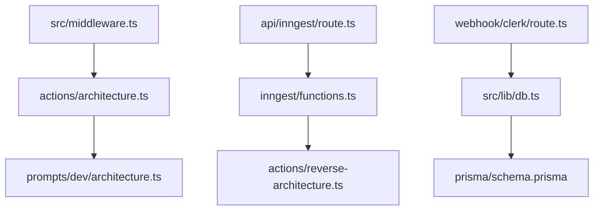

# lak7/devildev

> Workspace that generates and reverse-analyzes a software architecture from specifications or a repository.

## The problem
Code assistants write code before the architecture is laid out, and an existing repository remains hard to understand.

## What it actually does
A Next.js application: server actions (architecture, reverse-architecture, chat) produce the architecture through prompts and agent tools. Repository analysis runs through Inngest jobs triggered by GitHub webhooks. Clerk handles users, Prisma persists to PostgreSQL. The README states that it does not generate code today.

## How it is wired


## Trying it
```bash
git clone https://github.com/lak7/devildev.git
npx prisma generate
npx prisma migrate dev
npm run dev
```

## Cost and gotchas
Heavy setup: ngrok, Clerk, Supabase, Inngest, PostgreSQL, GitHub App, Dodo Payments. OpenAI and Parallel keys are mandatory, billed to you. The webhooks require a public URL.

## What it is not
It is not a code generator, and it is not simple to self-host.

## Alternatives
No alternative named in the README.

## For you
Ignore: the dependency on eight third-party services makes trying it out disproportionate for a promise of architecture.
