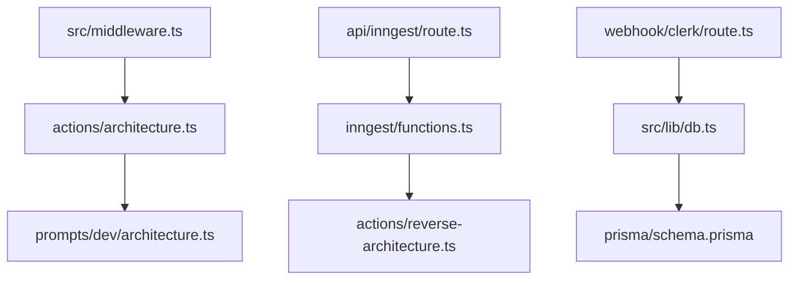

# lak7/devildev

> Espace de travail qui génère et rétro-analyse une architecture logicielle depuis des spécifications ou un dépôt.

## Le problème
Les assistants de code écrivent avant d'avoir posé l'architecture, et un dépôt existant reste difficile à comprendre.

## Ce que ça fait vraiment
Application Next.js : des actions serveur (architecture, reverse-architecture, chat) produisent l'architecture par prompts et outils d'agent. L'analyse d'un dépôt passe par des tâches Inngest déclenchées par les webhooks GitHub. Clerk gère les utilisateurs, Prisma persiste en PostgreSQL. Le README indique qu'il ne génère pas de code aujourd'hui.

## Comment c'est branché


## Essayer
```bash
git clone https://github.com/lak7/devildev.git
npx prisma generate
npx prisma migrate dev
npm run dev
```

## Coût et pièges
Installation lourde : ngrok, Clerk, Supabase, Inngest, PostgreSQL, GitHub App, Dodo Payments. Clés OpenAI et Parallel obligatoires, facturées à ta charge. Les webhooks exigent une URL publique.

## Ce que ce n'est pas
Ce n'est pas un générateur de code, et ce n'est pas simple à auto-héberger.

## Alternatives
Aucune alternative nommée dans le README.

## Pour toi
À ignorer : la dépendance à huit services tiers rend l'essai disproportionné pour une promesse d'architecture.

