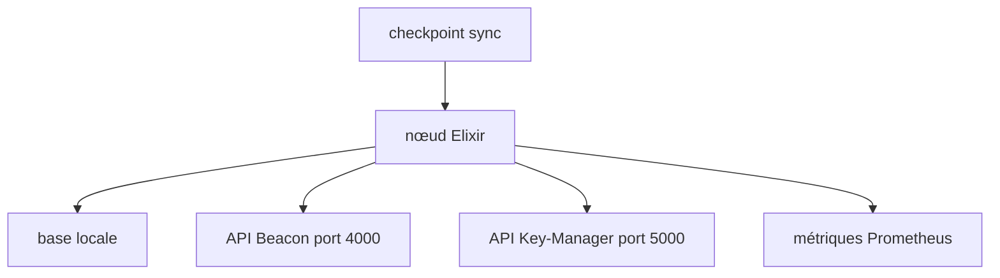

# lambdaclass/lambda_ethereum_consensus

> Ethereum consensus-layer client written in Elixir, for client diversity.

## The problem
Ethereum depends on the variety of its independent clients to stay resilient.

## What it actually does
Consensus client on the BEAM virtual machine. It runs on Sepolia to validate state transitions, and exposes a Beacon API (in progress) and a Key-Manager API, Prometheus metrics and spec tests. It cannot yet sync from genesis: checkpoint sync is mandatory.

## How it is wired


## Trying it
```bash
make deps
make iex
iex -S mix run -- --checkpoint-sync-url <your_url_here>
```

## Cost and gotchas
Free. Heavy prerequisites: Git, wget, CMake, Elixir, Erlang, Go, Rust, Protoc. No mainnet validator at this stage of the README.

## What it is not
Not a production-ready client: the MVP has not been reached. It does not cover the execution layer.

## Alternatives
No alternative named in the README.

## For you
Ignore: blockchain infrastructure, unrelated to your data or AI profile.
