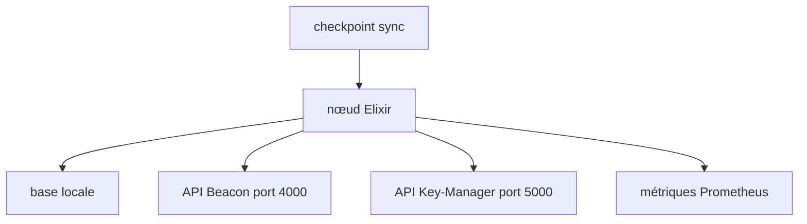

# lambdaclass/lambda_ethereum_consensus

> Client de la couche consensus d'Ethereum écrit en Elixir, pour la diversité des clients.

## Le problème
Ethereum dépend de la variété de ses clients indépendants pour rester résilient.

## Ce que ça fait vraiment
Client de consensus sur la machine virtuelle BEAM. Il tourne sur Sepolia pour valider les transitions d'état, expose une API Beacon (en cours) et une API Key-Manager, des métriques Prometheus et des tests de spec. Il ne sait pas encore synchroniser depuis le genesis : le checkpoint sync est obligatoire.

## Comment c'est branché


## Essayer
```bash
make deps
make iex
iex -S mix run -- --checkpoint-sync-url <your_url_here>
```

## Coût et pièges
Gratuit. Prérequis lourds : Git, wget, CMake, Elixir, Erlang, Go, Rust, Protoc. Pas de validateur sur réseau principal à ce stade du README.

## Ce que ce n'est pas
Pas un client prêt pour la production : le MVP n'est pas atteint. Ne couvre pas la couche d'exécution.

## Alternatives
Aucune alternative nommée dans le README.

## Pour toi
À ignorer : infrastructure blockchain, sans lien avec ton profil data ou IA.

