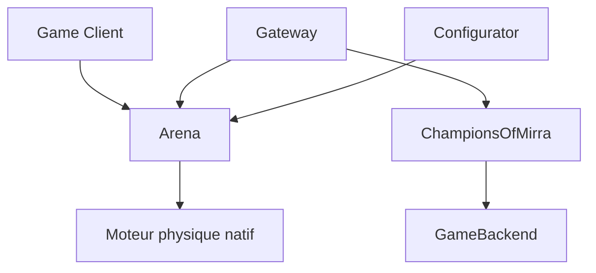

# lambdaclass/mirra_backend

> Elixir umbrella project for multiplayer games: real-time arena, websocket gateway and game logic.

## The problem
Splitting a game backend into independent applications that can be reused across several games.

## What it actually does
Applications: Arena (logic and 2D physics engine), Game Client, Gateway (websocket to the games), ChampionsOfMirra (battles, campaigns), GameBackend (shared persistence) and Configurator (immutable configurations, A/B). Load tests: 75 simultaneous games of 12 players before saturating 1 Gbps.

## How it is wired


## Trying it
```bash
git clone https://github.com/lambdaclass/mirra_backend.git
cd mirra_backend
devenv shell
devenv up
```

## Cost and gotchas
Nix and devenv must be installed; protobuf is installed through brew in the guide, so macOS. Last push in May 2025 and 141 open issues.

## What it is not
Not a ready-to-use game engine: a backend specific to these games, with future modules still to be written.

## Alternatives
- No alternative named in the README.

## For you
Ignore: a game backend in Elixir, unrelated to data / AI / MLOps.
