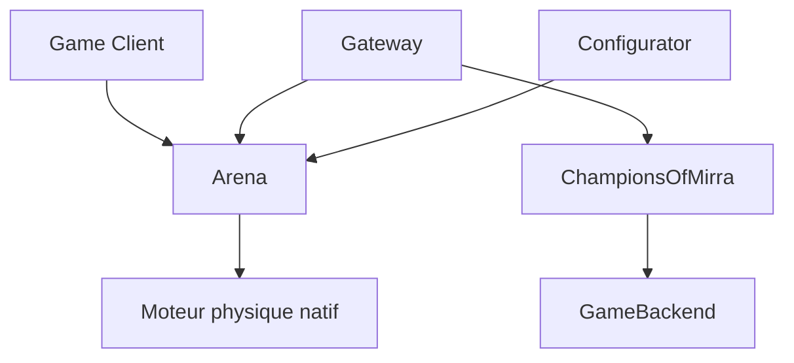

# lambdaclass/mirra_backend

> Projet Elixir umbrella pour jeux multijoueurs : arène temps réel, passerelle websocket et logique de jeu.

## Le problème
Découper un backend de jeu en applications indépendantes et réutilisables entre plusieurs jeux.

## Ce que ça fait vraiment
Applications Arena (logique et moteur physique 2D), Game Client, Gateway (websocket vers les jeux), ChampionsOfMirra (batailles, campagnes), GameBackend (persistance partagée) et Configurator (configurations immuables, A/B). Des tests de charge : 75 parties simultanées à 12 joueurs avant saturation de 1 Gbps.

## Comment c'est branché


## Essayer
```bash
git clone https://github.com/lambdaclass/mirra_backend.git
cd mirra_backend
devenv shell
devenv up
```

## Coût et pièges
Nix et devenv à installer ; protobuf installé par brew dans le guide, donc macOS. Dernier push en mai 2025 et 141 tickets ouverts.

## Ce que ce n'est pas
Pas un moteur de jeu prêt à l'emploi : un backend spécifique à ces jeux, avec des modules futurs encore à écrire.

## Alternatives
- Aucune alternative nommée dans le README.

## Pour toi
Ignorer : un backend de jeu en Elixir, sans lien avec data / IA / MLOps.

