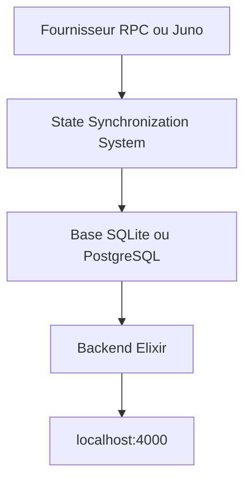

# lambdaclass/stark_compass_explorer

> Starknet block explorer in Elixir, for anyone running their own explorer.

## The problem
Browse Starknet blocks and transactions without depending on a third-party explorer.

## What it actually does
An Elixir backend that syncs with a Starknet RPC node: it listens for new blocks, catches up on old blocks, and updates non-finalized states. Storage is SQLite or PostgreSQL. It works up to Starknet 0.13.2. The team archived it to focus on Cairo VM and Cairo Native.

## How it is wired
Simplified diagram based on the sheet, no diagram provided.



## Trying it
```bash
make setup
make setup run
make run
```

## Cost and gotchas
Erlang 25, Elixir 1.15, SQLite. An RPC provider (Infura API key, or a Juno node with an Ethereum websocket RPC). Syncing makes many requests and uses a lot of disk; PostgreSQL is recommended for many blocks.

## What it is not
Not maintained and not compatible with recent Starknet versions.

## Alternatives
None cited in the README.

## For you
Ignore: archived, tied to a blockchain and to an outdated protocol version.
