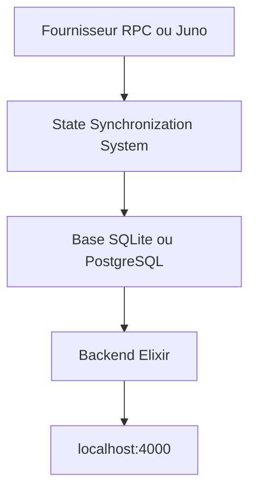

# lambdaclass/stark_compass_explorer

> Explorateur de blocs Starknet en Elixir, pour qui exploite son propre explorateur.

## Le problème
Consulter les blocs et transactions Starknet sans dépendre d'un explorateur tiers.

## Ce que ça fait vraiment
Un backend Elixir qui se synchronise avec un nœud RPC Starknet : écoute des nouveaux blocs, rattrapage des blocs anciens, mise à jour des états non finalisés. Stockage SQLite ou PostgreSQL. Fonctionne jusqu'à Starknet 0.13.2. L'équipe l'a archivé pour se concentrer sur Cairo VM et Cairo Native.

## Comment c'est branché
Schéma simplifié d'après la fiche, sans diagramme fourni.



## Essayer
```bash
make setup
make setup run
make run
```

## Coût et pièges
Erlang 25, Elixir 1.15, SQLite. Un fournisseur RPC (clé d'API Infura, ou nœud Juno avec un RPC Ethereum websocket). La synchronisation fait beaucoup de requêtes et consomme du disque ; PostgreSQL conseillé pour beaucoup de blocs.

## Ce que ce n'est pas
Pas maintenu et pas compatible avec les versions récentes de Starknet.

## Alternatives
Aucune citée dans le README.

## Pour toi
À ignorer : archivé, lié à une blockchain et à une version de protocole dépassée.

