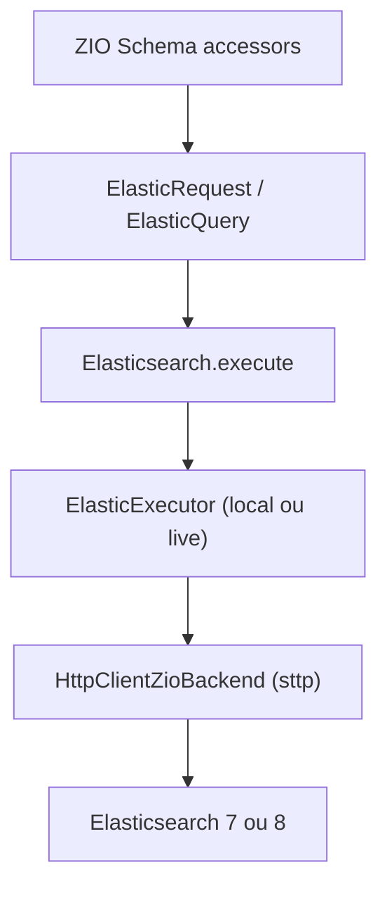

# lambdaworks/zio-elasticsearch

> Typed, streaming-friendly Elasticsearch client for Scala and ZIO.

## The problem
Writing Elasticsearch queries as raw JSON by hand in a Scala codebase lets type errors slip through.

## What it actually does
A Scala library that runs Elasticsearch queries through a ZIO layer. ZIO Schema schemas provide accessors for typed queries and aggregations. It offers a fluent API, bulk requests and streaming through scroll or search-after. It relies on sttp for HTTP and supports Elasticsearch 7 and 8.

## How it is wired


## Trying it
```scala
libraryDependencies += "io.lambdaworks" %% "zio-elasticsearch" % "0.5.1"
```

## Cost and gotchas
You need Scala 2.12, 2.13 or 3, ZIO 2 and a JVM 17+, plus a reachable Elasticsearch (localhost:9200 for the local executor). The real requirement is Scala and the JVM, which are not among the possible prerequisites listed.

## What it is not
It is not a client for Scala without ZIO. Streaming results return raw JSON in an Item, unless you use streamAs.

## Alternatives
- No alternative named in the README.

## For you
Ignore unless your stack is Scala and ZIO: otherwise an Elasticsearch client in your usual language is enough.
