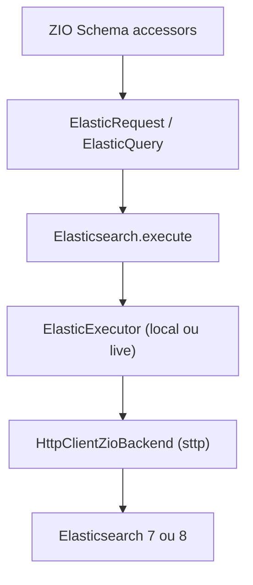

# lambdaworks/zio-elasticsearch

> Client Elasticsearch pour Scala et ZIO, typé et adapté au streaming.

## Le problème
Écrire des requêtes Elasticsearch en JSON à la main dans une base Scala laisse passer des erreurs de type.

## Ce que ça fait vraiment
Une bibliothèque Scala qui exécute des requêtes Elasticsearch via un layer ZIO. Les schémas ZIO Schema fournissent des accessors pour des requêtes et agrégations typées. Elle propose une API fluide, des requêtes bulk et du streaming par scroll ou search-after. Elle s'appuie sur sttp pour HTTP et supporte Elasticsearch 7 et 8.

## Comment c'est branché


## Essayer
```scala
libraryDependencies += "io.lambdaworks" %% "zio-elasticsearch" % "0.5.1"
```

## Coût et pièges
Il faut Scala 2.12, 2.13 ou 3, ZIO 2 et une JVM 17+, plus un Elasticsearch accessible (localhost:9200 pour l'exécuteur local). Le besoin réel est Scala et la JVM, non listés dans les prérequis possibles.

## Ce que ce n'est pas
Ce n'est pas un client pour Scala sans ZIO. Les résultats en streaming renvoient du JSON brut dans un Item, sauf avec streamAs.

## Alternatives
- Aucune alternative nommée dans le README.

## Pour toi
À ignorer sauf si ta pile est Scala et ZIO : sinon un client Elasticsearch dans ton langage habituel suffit.

