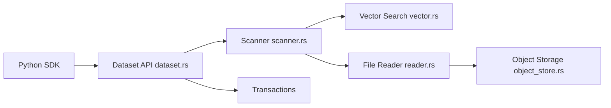

# lance-format/lance

> Open lakehouse format for multimodal AI: vector search, full-text search and fast random access.

## The problem
Parquet excels at SQL analytics but struggles with random access, embeddings and the multimodal data useful for AI.

## What it actually does
A file, table and catalog format on object storage, written in Rust with a Python (PyO3) and Java SDK. Vector indexes (IVF_PQ), scalar indexes and BM25 full-text search; versioning with transactions, tags and branches; adding columns without rewriting. Interoperates with Arrow, Pandas, DuckDB, Polars, Spark, Ray.

## How it is wired


## Trying it
```bash
pip install pylance
```
```python
import lance
lance.write_dataset(parquet, "/tmp/test.lance")
dataset = lance.dataset("/tmp/test.lance")
```

## Cost and gotchas
Free. Write with a stable `data_storage_version`; the `next` alias is unstable. 1,212 open issues. "100× faster" figures should be checked on your own data.

## What it is not
Not a turnkey vector database server: it is a format and a library. Not a replacement for a SQL warehouse.

## Alternatives
Parquet, Iceberg and Delta Lake (compared in the README): better for pure SQL analytics.

## For you
Adopt it to store embeddings, images and features with hybrid search, while staying within the Arrow/DuckDB/Pandas ecosystem.
