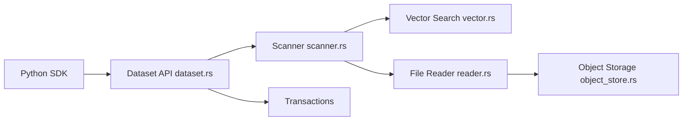

# lance-format/lance

> Format de lakehouse ouvert pour l'IA multimodale : recherche vectorielle, plein texte et accès aléatoire rapide.

## Le problème
Parquet excelle en analytique SQL mais peine sur l'accès aléatoire, les embeddings et les données multimodales utiles à l'IA.

## Ce que ça fait vraiment
Un format de fichier, de table et de catalogue sur stockage objet, écrit en Rust avec SDK Python (PyO3) et Java. Index vectoriels (IVF_PQ), scalaires et plein texte BM25 ; versionnage avec transactions, tags et branches ; ajout de colonnes sans réécriture. Interopère avec Arrow, Pandas, DuckDB, Polars, Spark, Ray.

## Comment c'est branché


## Essayer
```bash
pip install pylance
```
```python
import lance
lance.write_dataset(parquet, "/tmp/test.lance")
dataset = lance.dataset("/tmp/test.lance")
```

## Coût et pièges
Gratuit. Écrire avec une `data_storage_version` stable ; l'alias `next` est instable. 1 212 issues ouvertes. Chiffres « 100× plus rapide » à vérifier sur tes données.

## Ce que ce n'est pas
Pas une base vectorielle serveur clé en main : c'est un format et une bibliothèque. Pas un remplaçant d'un entrepôt SQL.

## Alternatives
Parquet, Iceberg et Delta Lake (comparés dans le README) : meilleurs pour l'analytique SQL pure.

## Pour toi
À adopter pour stocker embeddings, images et features avec recherche hybride, en restant dans l'écosystème Arrow/DuckDB/Pandas.

