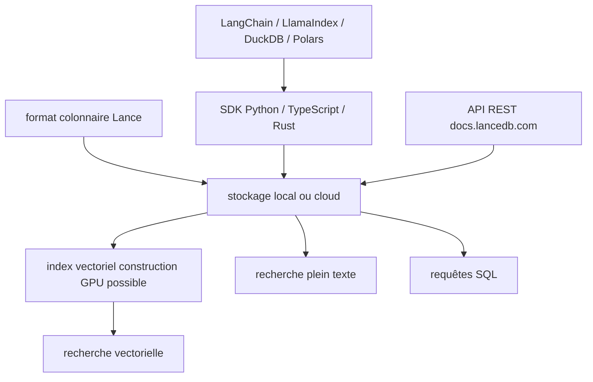

# lancedb/lancedb

> Embeddable multimodal database and vector search, built on the Lance columnar format.

## The problem
Storing vectors, metadata and multimodal data in three different systems forces you to synchronize them by hand.
Versioning datasets usually requires dedicated infrastructure.

## What it actually does
Stores, indexes and queries vectors, metadata and multimodal data (text, images, videos, point clouds) on the Lance columnar format.
Three search modes: vector similarity, full-text search and SQL, on the same storage.
Zero-copy and automatic data versioning, with no extra infrastructure; the GPU can be used to build the index.
Python, Node.js/TypeScript, Rust SDKs and REST API; integrations with LangChain, LlamaIndex, Arrow, Pandas, Polars, DuckDB.

## How it is wired

## Trying it
No install command in the README: it points to the Quickstart and the SDK pages.

## Cost and gotchas
The open source runs locally or in your cloud; the Cloud and Enterprise offers are paid, hence freemium.
Gotcha: the README is promotional and gives no command; the real evaluation starts with the external Quickstart.

## What it is not
Not an embedding engine: it indexes vectors, it does not produce them.
Not a general-purpose analytics warehouse, despite the word "lakehouse": the entry point is vector search.
Not a managed service in its open source version: having no server to manage is the promise of the Cloud offer.

## Alternatives
No alternative named; the cited repos (LangChain, LlamaIndex, DuckDB, Polars) are integrations.

## For you
Good choice of embedded vector database when you want to version your data and avoid a service to operate.
