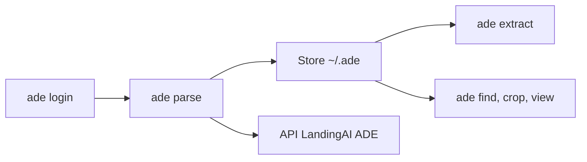

# landing-ai/agentic-doc

> LandingAI CLI for extracting text and structured fields from documents with position evidence.

## The problem
Extracting tables, figures and fields from a PDF, while knowing where each value comes from, is laborious.

## What it actually does
`ade parse` produces Markdown, elements and page-and-box location; `ade extract` fills a JSON schema with the evidence for each field; `ade find` searches locally, `ade crop` exports a region as PNG, `ade view` opens an HTML viewer. Everything is stored in `~/.ade`: rerunning an identical command does not consume credits. `--json` output for agents.

## How it is wired


## Trying it
```sh
curl -fsSL https://raw.githubusercontent.com/landing-ai/ade-cli/main/scripts/install.sh | sh
ade login
ade parse -d invoice.pdf
ade extract JOB_ITEM_ID --schema schema.json
```

## Cost and gotchas
An account and an API key (`ADE_API_KEY`) are required; parsing consumes credits. Never delete the whole `~/.ade`: it contains results already paid for.

## What it is not
It is no longer the Python SDK `agentic-doc`: that is kept without development on the `legacy` branch, and the repository has shipped the CLI since 2026-07-31. The provided architecture diagram describes the old SDK.

## Alternatives
No alternative named in the README.

## For you
Worth watching: useful for large-scale document extraction, but dependent on a paid SaaS and with no declared license.
