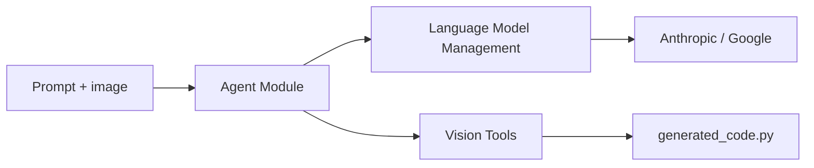

# landing-ai/vision-agent

> Agent that turns a prompt and an image into executable vision code, for developers of visual applications.

## The problem
Choosing and chaining the right vision models (detection, counting, tracking) for a given task is time-consuming.

## What it actually does
`VisionAgentCoderV2` plans, generates code and a test, then iterates until the test passes. The tools (detection, counting, video tracking, overlay) can also be called on their own via `vision_agent.tools`. Default models: Claude 3.7 Sonnet and Gemini Flash 2.0, configurable in `vision_agent/configs/config.py`.

## How it is wired


## Trying it
```bash
pip install vision-agent
export VISION_AGENT_API_KEY="your-api-key"
export ANTHROPIC_API_KEY="your-api-key"
export GOOGLE_API_KEY="your-api-key"
```

## Cost and gotchas
Three keys: VisionAgent, Anthropic and Google, with their quotas. The tools rely on models served by LandingAI. Last push in January 2026.

## What it is not
Not a standalone vision model: it depends on external LLMs and the LandingAI API. The generated code must be checked.

## Alternatives
The README names no alternative.

## For you
Worth watching: handy for prototyping vision, but three paid or limited accounts make it an external dependency.
