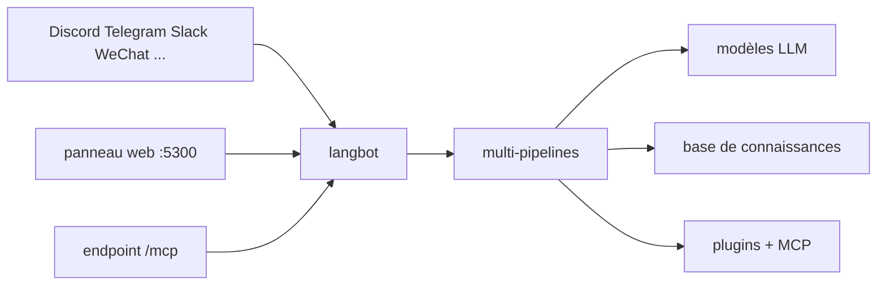

# langbot-app/LangBot

> A platform for plugging an LLM agent into messaging apps: Slack, Discord, Telegram, WeChat and others.

## The problem
Shipping the same assistant on Slack, Discord, Telegram and WeCom means maintaining four integrations.
And each platform has its own message formats, rate limits and moderation constraints.

## What it actually does
One codebase for Discord, Telegram, Slack, LINE, QQ, WeChat, WeCom, Lark, DingTalk, KOOK.
Multi-turn dialogues, tool calling, multimodal, streamed output, and built-in RAG connected to Dify, Coze, n8n, Langflow.
Access control, rate limiting, sensitive-word filtering, monitoring and exception handling.
Web configuration panel at `http://localhost:5300`: no YAML to edit by hand.

## How it is wired


## Trying it
```bash
uvx langbot
```
Or with containers: `git clone https://github.com/langbot-app/LangBot`, `cd LangBot/docker`,
`docker compose --profile all up -d`.

## Cost and gotchas
You need `uv` for the one-line launch, and your own model keys. LangBot Cloud exists
as a hosted version: it is a third-party service, not the same scope as self-hosting.

## What it is not
Not an agent: it is the transport and governance layer around an agent that you configure.
Not a knowledge base: RAG relies on external integrations (Dify, Coze, Weknora).
Not ecosystem-neutral: a good share of the platforms covered are Chinese (QQ, WeCom, Lark, DingTalk).

## Alternatives
`Dify`, `Coze`, `n8n`, `Langflow`, `Deerflow`, `Weknora` — built in, so directly usable if the IM bot is not your need.

## For you
Useful the day an internal assistant has to live in Slack or Teams; otherwise it is messaging plumbing.
