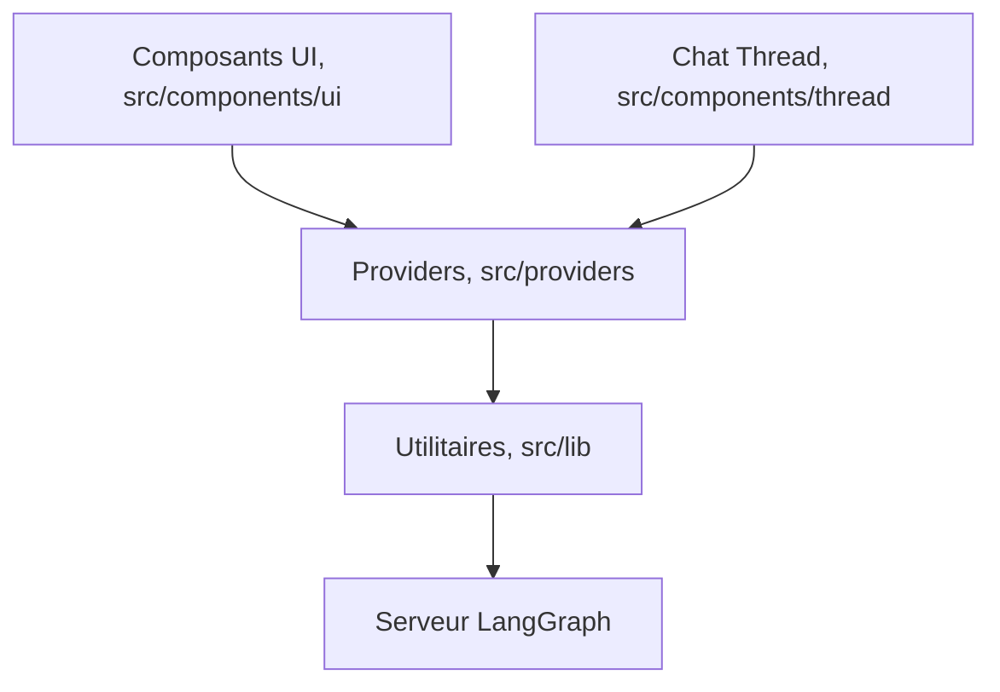

# langchain-ai/agent-chat-ui

> Next.js chat application for talking to any LangGraph server exposing a `messages` key.

## The problem
Testing a LangGraph agent requires a chat interface that gets rebuilt for every project, with streaming, tools and artifacts.

## What it actually does
The interface connects to a LangGraph deployment URL and a graph ID, then displays streamed messages, tool calls and an artifacts panel. Tags let you hide messages (`langsmith:nostream`, `do-not-render-` prefix). A proxy route can inject the LangSmith key server-side.

## How it is wired


## Trying it
```bash
git clone https://github.com/langchain-ai/agent-chat-ui.git
cd agent-chat-ui
pnpm install
pnpm dev
```

## Cost and gotchas
You need a LangGraph server and, for a remote deployment, a LangSmith key. The README warns that the proxy does not authenticate callers: anyone who can reach the URL can read and delete threads and launch runs billed to your account. Repository archived.

## What it is not
It is not an agent or a backend: only a chat client. It is not ready to be exposed to the public as is.

## Alternatives
No alternative named in the README.

## For you
Worth watching: useful to quickly test a LangGraph agent internally, but archived and dangerous to expose without proper authentication.
