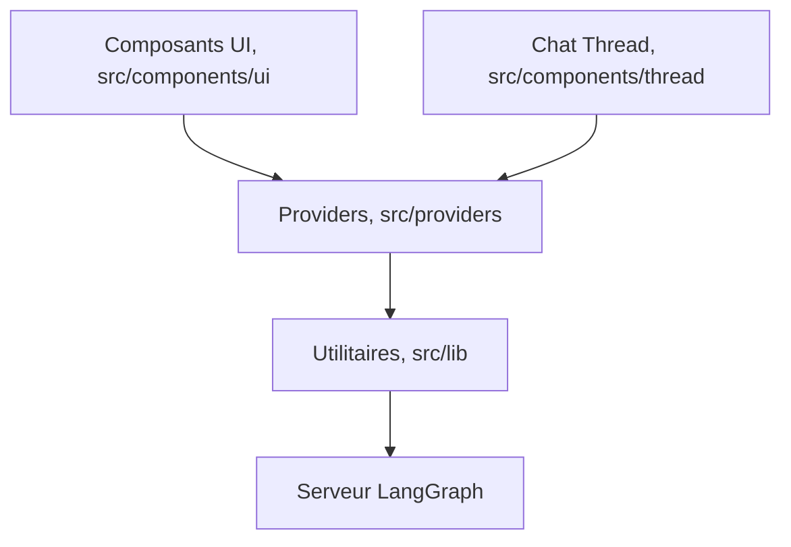

# langchain-ai/agent-chat-ui

> Application Next.js de chat pour dialoguer avec n'importe quel serveur LangGraph exposant une clé `messages`.

## Le problème
Tester un agent LangGraph demande une interface de chat que l'on rebâtit à chaque projet, avec flux, outils et artefacts.

## Ce que ça fait vraiment
L'interface se connecte à une URL de déploiement LangGraph et à un identifiant de graphe, puis affiche les messages en flux, les appels d'outils et un panneau d'artefacts. Des tags permettent de masquer des messages (`langsmith:nostream`, préfixe `do-not-render-`). Une route proxy peut injecter la clé LangSmith côté serveur.

## Comment c'est branché


## Essayer
```bash
git clone https://github.com/langchain-ai/agent-chat-ui.git
cd agent-chat-ui
pnpm install
pnpm dev
```

## Coût et pièges
Il faut un serveur LangGraph et, pour un déploiement distant, une clé LangSmith. Le README avertit que le proxy ne authentifie pas les appelants : toute personne atteignant l'URL peut lire, effacer des threads et lancer des runs facturés à ton compte. Dépôt archivé.

## Ce que ce n'est pas
Ce n'est pas un agent ni un backend : seulement un client de chat. Il n'est pas prêt à être exposé tel quel au public.

## Alternatives
Aucune alternative nommée dans le README.

## Pour toi
À surveiller : utile pour tester vite un agent LangGraph en interne, mais archivé et dangereux à exposer sans authentification propre.

