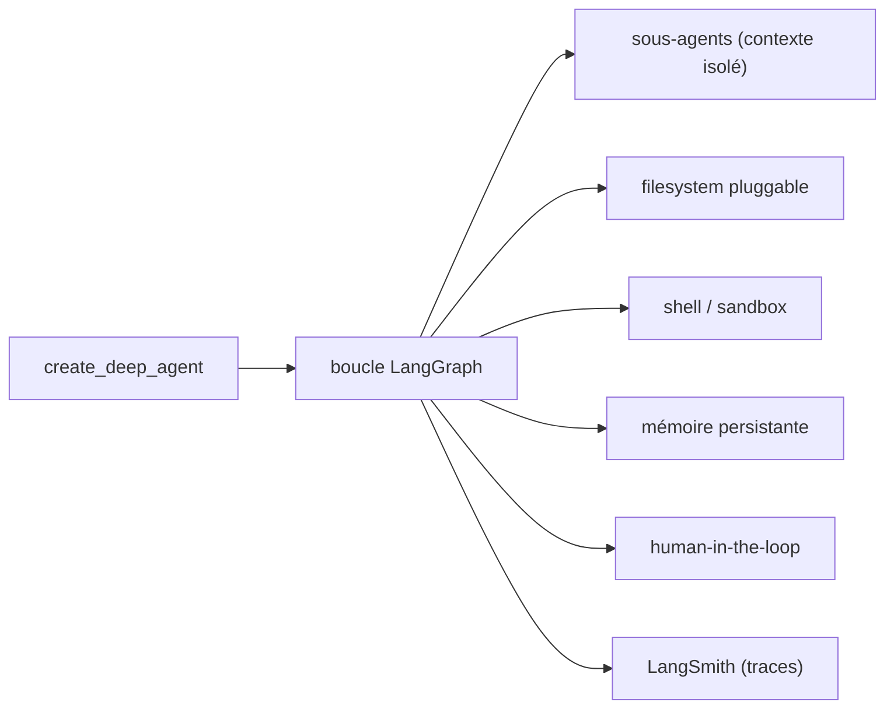

# langchain-ai/deepagents

> Ready-to-use agent harness for long-running tasks, built on LangGraph.

## The problem
An agent that works for hours loses its context, forgets its files and cannot delegate.
Assembling sub-agents, a file system and context compaction yourself amounts to rewriting a harness.

## What it actually does
`create_deep_agent` returns an agent that plans, reads/writes files and manages its own context.
Sub-agents with isolated windows, local/sandbox/remote file backends, shell access, persistent memory.
Human-in-the-loop: approve, edit or reject a tool call before execution; skills loadable on demand.
Every component can be replaced without forking; any LangGraph `CompiledStateGraph` plugs in as a sub-agent.

## How it is wired


## Trying it
```bash
uv add deepagents
curl -LsSf https://langch.in/dcode | bash
```

## Cost and gotchas
The model is at your expense: frontier API key, open-weight provider, or local model via Ollama, vLLM, llama.cpp.
Tracing, evaluation and deployment go through LangSmith, a third-party service.

## What it is not
It is not a security sandbox: the trust model is "trust the LLM", limits are set at the tool level.
It is not LangGraph: it is an opinionated layer on top of `create_agent`, itself on top of the graph runtime.
It is not the right tool if the agent loop is not the shape you want — you then need to drop down to LangGraph.

## Alternatives
LangChain `create_agent`: minimal harness, without the built-in middleware, when you want less.
LangGraph: the raw graph runtime, when the agent loop does not fit the need.
deepagents.js: the same library for JavaScript/TypeScript.

## For you
Worth a look if you are already on LangGraph; otherwise the cost of entering the ecosystem outweighs the gain.
