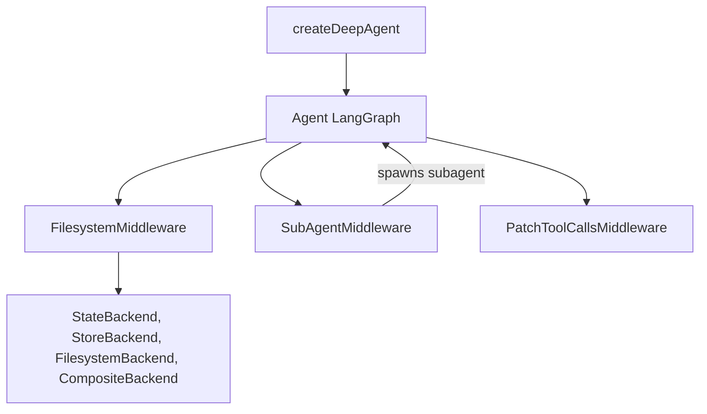

# langchain-ai/deepagentsjs

> TypeScript library for building "deep" agents with planning, subagents and files, on LangGraph.

## The problem
A simple LLM agent runs out of steam on long tasks: no plan, no working memory, no delegation.

## What it actually does
`createDeepAgent` assembles a LangGraph agent with default middlewares: a to-do list, file tools, subagents with isolated context. Interchangeable backends store the state: in memory, persistent store, local disk or composite. LangChain tools, validated by Zod, are added on the user side.

## How it is wired

## Trying it
No command documented in the excerpt provided: the README points to `libs/deepagents/README.md`. Examples exist in `examples/backends` and `examples/research`.

## Cost and gotchas
Calls to the model (and to Tavily in the research example) are billed by your providers. Subagents multiply the calls.

## What it is not
Not a ready-to-use agent: it is an assembly to configure. It is tied to the LangChain/LangGraph ecosystem.

## Alternatives
No alternative named in the README.

## For you
Worth watching: relevant for long agents in TypeScript, but you must accept the dependency on LangGraph and a token cost that is hard to bound.
