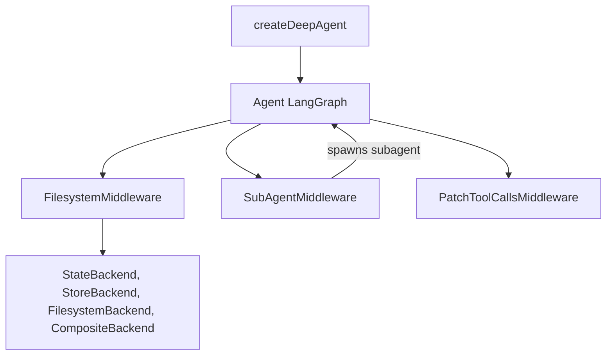

# langchain-ai/deepagentsjs

> Bibliothèque TypeScript pour construire des agents « profonds » avec planification, sous-agents et fichiers, sur LangGraph.

## Le problème
Un agent LLM simple s'essouffle sur les tâches longues : pas de plan, pas de mémoire de travail, pas de délégation.

## Ce que ça fait vraiment
`createDeepAgent` assemble un agent LangGraph avec des middlewares par défaut : liste de tâches, outils de fichiers, sous-agents à contexte isolé. Des backends interchangeables stockent l'état : en mémoire, store persistant, disque local ou composite. Des outils LangChain, validés par Zod, s'ajoutent côté utilisateur.

## Comment c'est branché

## Essayer
Aucune commande documentée dans l'extrait fourni : le README renvoie à `libs/deepagents/README.md`. Des exemples existent dans `examples/backends` et `examples/research`.

## Coût et pièges
Les appels au modèle (et à Tavily dans l'exemple de recherche) sont facturés par tes fournisseurs. Les sous-agents multiplient les appels.

## Ce que ce n'est pas
Pas un agent prêt à l'emploi : c'est un assemblage à configurer. Il est lié à l'écosystème LangChain/LangGraph.

## Alternatives
Aucune alternative nommée dans le README.

## Pour toi
À surveiller : pertinent pour des agents longs en TypeScript, mais il faut accepter la dépendance à LangGraph et un coût de tokens difficile à borner.

