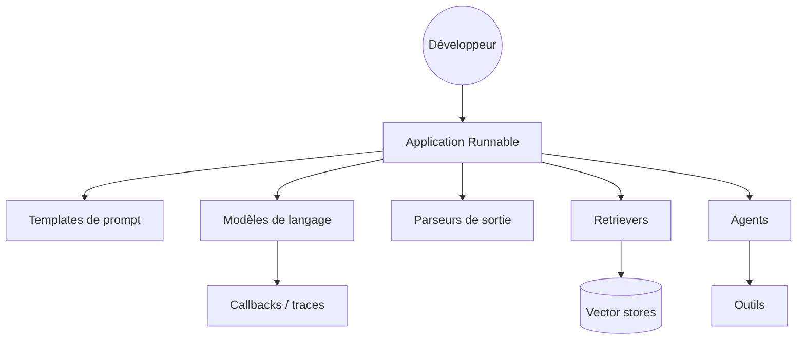

# langchain-ai/langchain

> Python library of common abstractions for models, tools, and retrieval, designed for LLM developers.

## The problem
Each model provider has its own SDK, message format, and API syntax.
Switching to a different model during a project requires rewriting the API layer.

## What it actually does
Unique interface for chat models, embeddings, vector stores, retrievers, and tools.
`init_chat_model("openai:gpt-5.5")` followed by `.invoke()`: the same code applies to other providers.
Provides an indexing API that tracks documents already indexed in an SQL registry.
Callback and tracing system, which can be connected to LangSmith for observability.

## How it is wired


## Trying it
```bash
uv add langchain
```
```python
from langchain.chat_models import init_chat_model
model = init_chat_model("openai:gpt-5.5")
result = model.invoke("Hello, world!")
```

## Cost and gotchas
The library is free to use; usage charges are applied by your provider.

LangSmith, presented as an observability companion, is a separate paid service.

## What it is not
Not a workflow orchestration framework: for controllable workflows, the README refers to LangGraph.
Abstractions have a cost – an extra layer between your code and the provider's API.
"Production-ready" and "battle-tested" are terms used in the README, not guarantees.

## Alternatives
- `langflow-ai/langflow`: The same thing, but visually, for creating layouts without code.
- `browser-use/browser-use`: if the need is for a browser agent, not an abstraction layer.

## For you
The standard format; particularly useful for ensuring interoperability between models. It's important to be aware of, but should be used judiciously.
