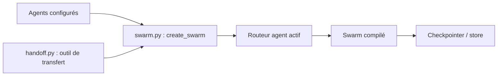

# langchain-ai/langgraph-swarm-py

> Python library for LangGraph agent swarms that hand off to each other according to their specialty.

## The problem
In a multi-agent system, you must decide which agent answers and remember which one was active on the previous turn.

## What it actually does
`create_swarm` assembles agents into a LangGraph graph; `create_handoff_tool` generates the handoff tool between agents. The last active agent is stored in the state, provided you compile with a checkpointer. By default, the entire message history is passed during the handoff; handoff tools and state schemas are customizable. Short and long-term memory, streaming and human validation come from LangGraph.

## How it is wired


## Trying it
```bash
pip install langgraph-swarm
pip install langgraph-swarm langchain-openai
export OPENAI_API_KEY=<your_api_key>
```

## Cost and gotchas
API key of the chosen model (the example uses OpenAI). Without a checkpointer, the swarm forgets the active agent and the history.

## What it is not
Not a standalone framework: it depends on LangGraph. Messages from all agents are merged by default, which exposes their internal history.

## Alternatives
No alternative named in the README.

## For you
Worth watching: small and useful if you are already on LangGraph; last push in July 2026, to check before building on it.
