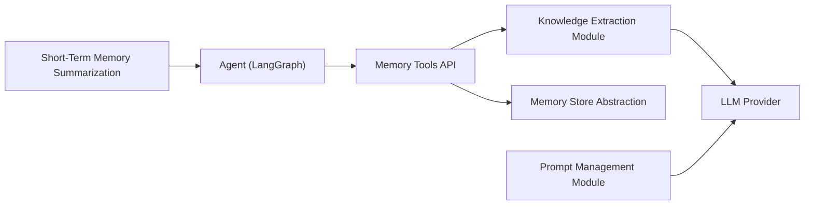

# langchain-ai/langmem

> Long-term memory library for LangGraph agents, which extracts and retrieves information from conversations.

## The problem
An agent forgets everything from one session to the next and does not adapt to user preferences.

## What it actually does
Provides memory tools (`create_manage_memory_tool`, `create_search_memory_tool`) that the agent calls during the conversation, a background memory manager that extracts and consolidates knowledge, prompt optimization and short-term context summarization. Storage goes through LangGraph's `BaseStore` (`InMemoryStore` is volatile, `AsyncPostgresStore` persists).

## How it is wired


## Trying it
```bash
pip install -U langmem
export ANTHROPIC_API_KEY="sk-..."
```
```python
from langgraph.prebuilt import create_react_agent
from langgraph.store.memory import InMemoryStore
from langmem import create_manage_memory_tool, create_search_memory_tool
```

## Cost and gotchas
Requires a key from an LLM provider; the example uses OpenAI embeddings. Extraction and search calls consume tokens at your expense; `InMemoryStore` loses everything on restart.

## What it is not
Not a standalone knowledge base: it relies on LangGraph and an LLM to decide what to retain. Memory quality is not measured in the README.

## Alternatives
No alternative named in the README.

## For you
Worth watching: simple to integrate if you are already on LangGraph; without LangGraph, the appeal drops significantly.
