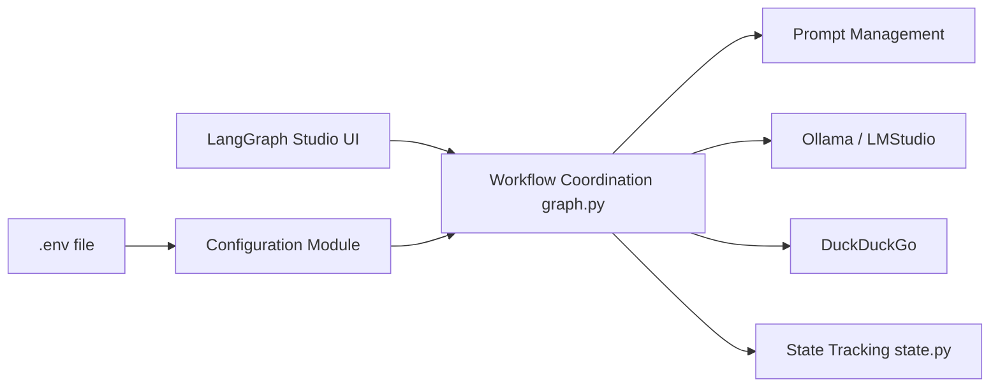

# langchain-ai/local-deep-researcher

> LangGraph graph for iterative web research that runs with a local LLM via Ollama or LMStudio.

## The problem
"Deep research" assistants rely on paid APIs and send your queries to the cloud.

## What it actually does
Starting from a topic, the local LLM generates a query, a search engine (DuckDuckGo by default, otherwise SearXNG, Tavily, Perplexity) returns sources, the LLM summarizes, spots gaps and loops again, for an adjustable number of iterations. Output: a Markdown summary with citations, viewable in LangGraph Studio. A fallback handles models that fail to produce the JSON output.

## How it is wired


## Trying it
```bash
git clone https://github.com/langchain-ai/local-deep-researcher.git
cd local-deep-researcher
cp .env.example .env
ollama pull deepseek-r1:8b
uvx --refresh --from "langgraph-cli[inmem]" --with-editable . --python 3.11 langgraph dev
docker build -t local-deep-researcher .
```

## Cost and gotchas
Free with Ollama and DuckDuckGo; Tavily or Perplexity require a key. The Studio UI is served by smith.langchain.com, a known issue on Safari.

## What it is not
Not a finished product with its own interface: it is a graph to run inside LangGraph. The Dockerfile does not bundle Ollama.

## Alternatives
- ollama-deep-researcher-ts: TypeScript port (without Perplexity) if your stack is JS.

## For you
Adopt as a template: a small, readable, 100% local LangGraph graph that shows the query-summarize-reflect loop, ideal to fork for an internal monitoring assistant.
