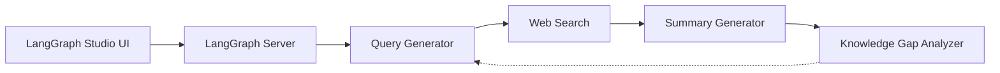

# langchain-ai/ollama-deep-researcher

> Local web research assistant (Local Deep Researcher) that loops search, summarization and gap analysis with Ollama or LMStudio.

## The problem
Getting a sourced summary on a topic without sending your queries to a hosted LLM.

## What it actually does
A LangGraph graph: the local LLM generates a query, the search (DuckDuckGo by default, Tavily, Perplexity or SearXNG) brings back sources, the LLM summarizes then identifies gaps and loops again, up to 3 cycles by default. Output: a markdown summary with sources, visible in LangGraph Studio. Inspired by IterDRAG.

## How it is wired


## Trying it
```bash
git clone https://github.com/langchain-ai/local-deep-researcher.git
cd local-deep-researcher
cp .env.example .env
ollama pull deepseek-r1:8b
uvx --refresh --from "langgraph-cli[inmem]" --with-editable . --python 3.11 langgraph dev
```

## Cost and gotchas
Free with DuckDuckGo; Tavily or Perplexity keys are optional. Ollama or LMStudio to install. Some small models (DeepSeek R1 1.5B and 7B) fail on structured JSON: a fallback exists. Docker does not include Ollama.

## What it is not
Not a product-grade deep search engine: quality depends on the local model. The diagram provided has no readable components.

## Alternatives
- ollama-deep-researcher-ts: TypeScript port without Perplexity.

## For you
Worth watching: a good teaching example of a local research loop under LangGraph; to be judged on the quality of your model.
