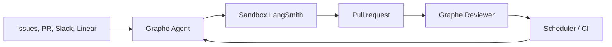

# langchain-ai/open-swe

> Self-hostable software development agent that takes a task and delivers a pull request.

## The problem
Coding agents remain local toys: no persistent sandbox, no integration with issues,
no CI or review tracking, and nothing auditable on the repository permissions side.

## What it actually does
Receives a task from the dashboard, GitHub, Slack, Linear or a schedule, runs it in an isolated Linux
sandbox tied to the thread, then pushes a PR. Five separate LangGraph graphs: Agent,
Reviewer, Analyzer, Chat, Scheduler. The Reviewer learns the repository's review style; `/baby-sit`
watches CI and reruns flaky jobs with evidence. Deep Agents provides planning, files, shell, sub-agents.

## How it is wired


## Trying it
```bash
git clone https://github.com/langchain-ai/open-swe.git
cd open-swe
uv venv
source .venv/bin/activate
uv sync --all-extras
make build-dashboard
make dev
```

## Cost and gotchas
You need to create a GitHub App and a Slack app, supply model providers, and an ngrok tunnel
for webhooks locally. Self-hosting in production requires the LangGraph Agent Server **and its license
key**. LangSmith is the default sandbox provider.

## What it is not
Not a stable product: the README says the APIs and surfaces are still evolving. Not free at scale
— sandbox, models and server license are billed. The desktop client is experimental, packaged for macOS.

## Alternatives
- **Deep Agents**: the harness alone, if you want to build your own tooling.
- **LangGraph**: the durable runtime, without the product layer.

## For you
Interesting as a reference architecture; adopting it means accepting the LangSmith dependency.
