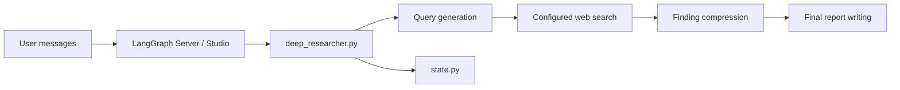

# langchain-ai/open_deep_research

> Configurable LangGraph deep research agent, multi-provider for models and web search.

## The problem
Commercial "deep research" agents are closed; reproducing their sourced search-and-synthesis loop takes a lot of plumbing.

## What it actually does
A LangGraph graph (`deep_researcher.py`) generates queries, iterates searches (Tavily by default, native OpenAI/Anthropic search or MCP), summarizes, compresses, then writes a report.
Four distinct models (summarization, research, compression, report), chosen in `configuration.py`.
Run via LangGraph Server/Studio; evaluation on Deep Research Bench via LangSmith.
Two old implementations in `src/legacy/`.

## How it is wired


## Trying it
```bash
git clone https://github.com/langchain-ai/open_deep_research.git
cd open_deep_research
uv venv
source .venv/bin/activate
uv sync
cp .env.example .env
uvx --refresh --from "langgraph-cli[inmem]" --with-editable . --python 3.11 langgraph dev --allow-blocking
```

## Cost and gotchas
LLM keys (OpenAI by default) and Tavily are at your expense; the full evaluation costs $20 to $100.
Models must handle structured outputs and tool calls.

## What it is not
Archived repository: no more fixes to expect.
Not a ready-to-use application: it is a graph to host on LangGraph.

## Alternatives
No alternative named in the README apart from the legacy implementations in the same repository.

## For you
Worth watching as an architecture reference for a research agent (steps, separate models, evaluation), but the archiving rules out making it a dependency.
