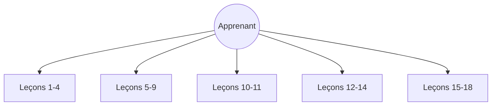

# langchain-ai/rag-from-scratch

> Notebooks accompanying a video series that teaches RAG, from indexing to generation.

## The problem
LLMs know nothing about private or recent data; fine-tuning is expensive and ill-suited to fact recall.

## What it actually does
Five Jupyter notebooks group lessons 1 to 18 (1-4, 5-9, 10-11, 12-14, 15-18), to be followed alongside the video playlist. The README does not detail their content beyond indexing, retrieval and generation: the rest is not documented.

## How it is wired

## Trying it
No command documented in the README; open the notebooks `rag_from_scratch_1_to_4.ipynb` and the following ones.

## Cost and gotchas
The notebooks presumably call model APIs at your expense, but the README does not say so. No license declared: reuse is uncertain.

## What it is not
Not a library nor an application: a teaching resource. Last push in June 2025, so potentially behind on LangChain APIs.

## Alternatives
No alternative named in the README.

## For you
Keep an eye on it: a good educational entry point to RAG for an AI profile, with reservations about the age of the content and the lack of a license.
