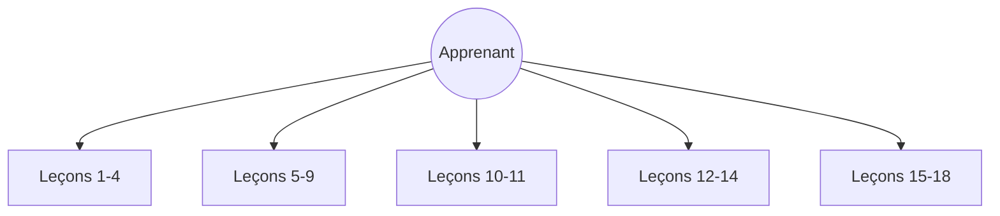

# langchain-ai/rag-from-scratch

> Notebooks accompagnant une série vidéo qui apprend le RAG, de l'indexation à la génération.

## Le problème
Les LLM ignorent les données privées ou récentes ; le fine-tuning coûte cher et convient mal au rappel de faits.

## Ce que ça fait vraiment
Cinq notebooks Jupyter regroupent les leçons 1 à 18 (1-4, 5-9, 10-11, 12-14, 15-18), à suivre avec la playlist vidéo. Le README ne détaille pas leur contenu au-delà de l'indexation, la recherche et la génération : le reste n'est pas documenté.

## Comment c'est branché

## Essayer
Aucune commande documentée dans le README ; ouvrir les notebooks `rag_from_scratch_1_to_4.ipynb` et suivants.

## Coût et pièges
Les notebooks appellent vraisemblablement des API de modèles à ta charge, mais le README ne le précise pas. Aucune licence déclarée : réutilisation incertaine.

## Ce que ce n'est pas
Pas une bibliothèque ni une application : un support pédagogique. Dernier push en juin 2025, donc potentiellement en retard sur les API LangChain.

## Alternatives
Aucune alternative nommée dans le README.

## Pour toi
À surveiller : bonne entrée pédagogique sur le RAG pour un profil IA, avec réserve sur l'âge du contenu et l'absence de licence.

