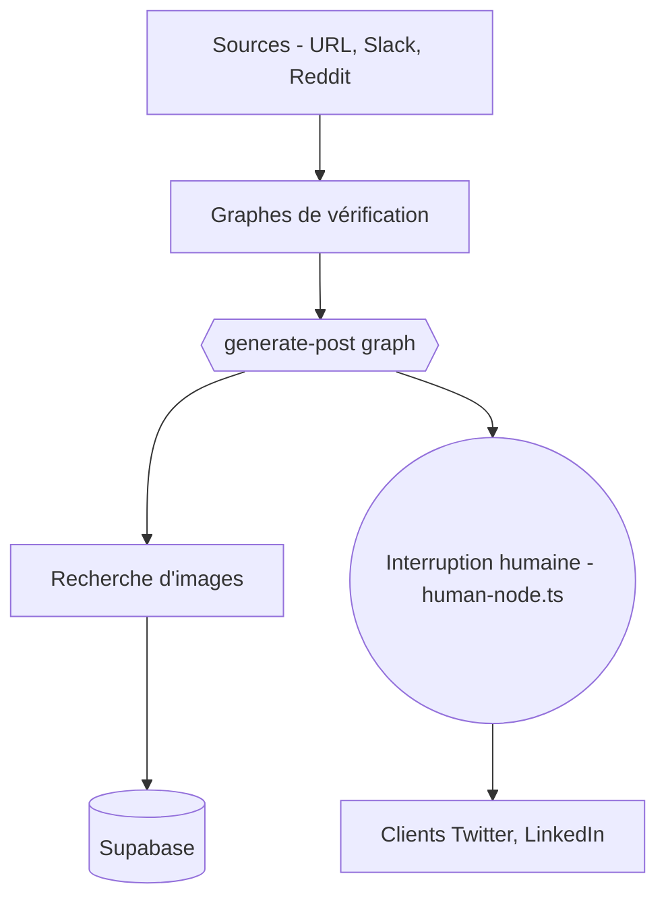

# langchain-ai/social-media-agent

> LangGraph agent that reads a URL, drafts a Twitter and LinkedIn post, then waits for your approval before publishing.

## The problem
Turning an article or a repository into posts tailored to each network takes time, and automation tools publish without human review.

## What it actually does
The `generate_post` graph fetches the content (Firecrawl, plus GitHub, YouTube or Slack in full mode), verifies it, generates a report and then a post, and pauses for human approval (accept, edit, reject) in the Agent Inbox. It publishes or schedules on Twitter and LinkedIn through Arcade or developer accounts. It can also search for images, stored in Supabase. The prompts are tuned for LangChain.

## How it is wired


## Trying it
```bash
git clone https://github.com/langchain-ai/social-media-agent.git
cd social-media-agent
yarn install
cp .env.quickstart.example .env
pip install langgraph-cli
yarn langgraph:in_mem:up
yarn generate_post
```

## Cost and gotchas
API keys at your expense: Anthropic, LangSmith, Firecrawl (500 free credits), Arcade. The advanced mode adds Vertex AI, Supabase, and Twitter and LinkedIn developer accounts. Setting up LinkedIn for company pages is long.

## What it is not
It is not an autonomous publisher: human approval is central. It is tuned for LangChain's AI content: prompts and examples must be replaced for any other use.

## Alternatives
No alternative named in the README.

## For you
Worth watching: a good example of a LangGraph agent with a human in the loop, to read and adapt, but production use requires many paid or account-based services.
