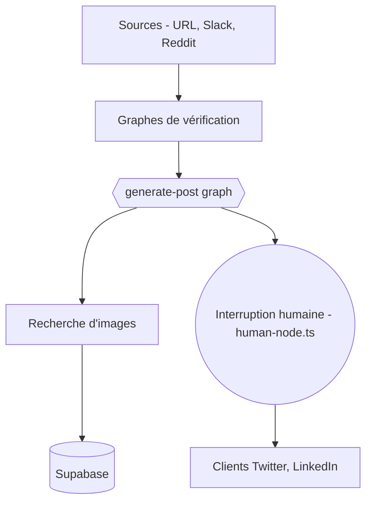

# langchain-ai/social-media-agent

> Agent LangGraph qui lit une URL, rédige un post Twitter et LinkedIn, puis attend ta validation avant publication.

## Le problème
Transformer un article ou un dépôt en publications adaptées à chaque réseau prend du temps, et les automatismes publient sans relecture humaine.

## Ce que ça fait vraiment
Le graphe `generate_post` récupère le contenu (Firecrawl, plus GitHub, YouTube ou Slack en mode complet), le vérifie, génère un rapport puis un post, et s'interrompt pour validation humaine (accepter, éditer, rejeter) dans l'Agent Inbox. Il publie ou planifie sur Twitter et LinkedIn via Arcade ou des comptes développeur. Il sait aussi chercher des images, stockées dans Supabase. Les prompts sont réglés pour LangChain.

## Comment c'est branché


## Essayer
```bash
git clone https://github.com/langchain-ai/social-media-agent.git
cd social-media-agent
yarn install
cp .env.quickstart.example .env
pip install langgraph-cli
yarn langgraph:in_mem:up
yarn generate_post
```

## Coût et pièges
Clés d'API à ta charge : Anthropic, LangSmith, Firecrawl (500 crédits gratuits), Arcade. Le mode avancé ajoute Vertex AI, Supabase, comptes développeur Twitter et LinkedIn. La configuration LinkedIn pour pages d'entreprise est longue.

## Ce que ce n'est pas
Ce n'est pas un publicateur autonome : la validation humaine est centrale. Il est réglé sur le contenu IA de LangChain : prompts et exemples sont à remplacer pour un autre usage.

## Alternatives
Aucune alternative nommée dans le README.

## Pour toi
À surveiller : bon exemple d'agent LangGraph avec humain dans la boucle à lire et à adapter, mais l'usage de production suppose beaucoup de services payants ou à comptes.

