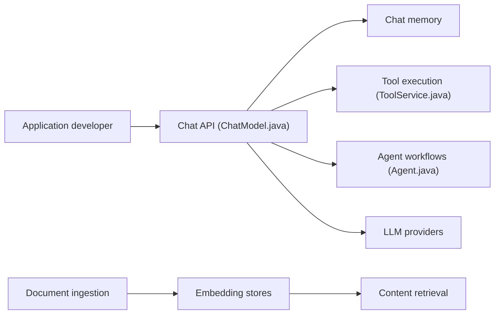

# langchain4j/langchain4j

> Idiomatic Java library for integrating LLMs, RAG and agents into JVM applications.

## The problem
Each LLM provider and each vector database has its own proprietary API, and few tools exist on the Java side.

## What it actually does
A unified API over 20+ LLM providers and 30+ embedding stores. Toolbox: prompt templates, chat memory, function calling, tools, agents, a RAG pipeline (ingestion, parsing, retrieval, query routing). Integrations with Quarkus, Spring Boot, Helidon and Micronaut. It is not a port of Python LangChain.

## How it is wired

## Trying it
The README contains no command: it points to the getting-started guide and the examples repository. No documented command.

## Cost and gotchas
Free; calls to providers are billed by them. The README says some features are still under development. 1,041 open issues.

## What it is not
Not a copy of LangChain: API, internals and release cycle are independent. Not a model nor a hosted service.

## Alternatives
No alternative named in the README.

## For you
Worth watching: keep in mind if your team industrializes in Java; in Python, better to stay with the native ecosystem.
