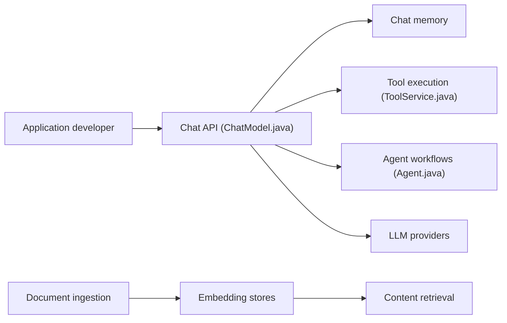

# langchain4j/langchain4j

> Bibliothèque Java idiomatique pour intégrer des LLM, RAG et agents dans des applications JVM.

## Le problème
Chaque fournisseur de LLM et chaque base vectorielle a son API propriétaire, et peu d'outils existent côté Java.

## Ce que ça fait vraiment
API unifiée sur 20+ fournisseurs de LLM et 30+ stockages d'embeddings. Boîte à outils : modèles de prompts, mémoire de chat, appels de fonctions, outils, agents, pipeline RAG (ingestion, parsing, récupération, routage de requêtes). Intégrations Quarkus, Spring Boot, Helidon et Micronaut. Ce n'est pas un portage de LangChain Python.

## Comment c'est branché

## Essayer
Le README ne contient aucune commande : il renvoie vers le guide de démarrage et le dépôt d'exemples. Aucune commande documentée.

## Coût et pièges
Gratuit ; les appels aux fournisseurs sont facturés par eux. Le README dit que certaines fonctions sont encore en développement. 1 041 issues ouvertes.

## Ce que ce n'est pas
Pas une copie de LangChain : API, internes et cycle de release sont indépendants. Pas un modèle ni un service hébergé.

## Alternatives
Aucune alternative nommée dans le README.

## Pour toi
À surveiller : à retenir si ton équipe industrialise en Java ; en Python, mieux vaut rester sur l'écosystème natif.

