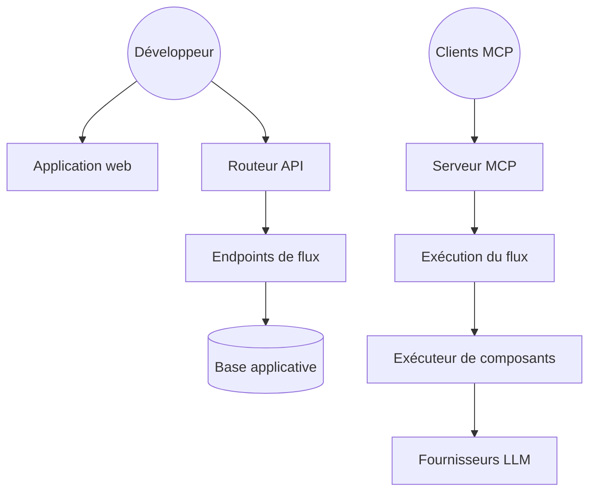

# langflow-ai/langflow

> A visual agent flow editor, which exposes each flow via API or a MCP server.

## The problem
Wiring an agent with code for each variant to test is expensive in terms of iterations.
And once the flow is established at the point, it still needs to be cleanly exposed to the applications.

## What it actually does
Graphical flow editor, with access to the Python code for each component to customize it.
Interactive playground for running a flow step-by-step and debugging it.
Deployment of the flow as a REST API, in exportable JSON, or as a MCP server consumed by an MCP client.
Integration with observability tools (LangSmith, LangFuse) and multi-agent orchestration with data retrieval.

## How it is wired


## Trying it
```shell
uv pip install langflow -U
uv run langflow run
docker run -p 7860:7860 langflowai/langflow:latest
```

## Cost and gotchas
The product is free; however, you are responsible for providing the necessary vector models and templates.
Python 3.10–3.14 is recommended, along with the `uv` library. The server listens on port 7860; do not expose it directly.

## What it is not
Not a replacement for code: visual flows quickly become unreadable beyond a certain number of nodes.
Not a managed runtime: hosting, authentication, and scaling still need to be handled.
"Enterprise-ready" is a claim in the README, not a verifiable property here.

## Alternatives
- `langchain-ai/langchain`: if the flow should reside within the code rather than in a template.
- `bytedance/deer-flow`: Orchestration of subprocesses, without a visual editor.

## For you
Useful for quickly creating mockups with non-developers; should not be used for critical tasks.
