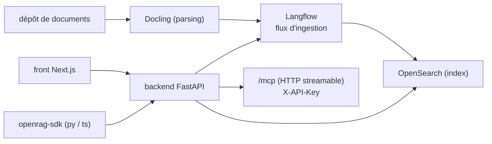

# langflow-ai/openrag

> Ready-to-use RAG platform: document ingestion, semantic search and chat.

## The problem
Setting up a RAG requires assembling a document parser, an index, a retrieval orchestrator and
a chat interface — four building blocks to wire up before the first question is asked.

## What it actually does
Ships the whole thing already wired: users drop, process and query documents through
a chat interface backed by LLMs and semantic search. Langflow handles ingestion,
retrieval workflows and "nudges", with a visual drag-and-drop workflow builder
to iterate. Ingestion is advertised as tolerant of malformed real-world data,
via Docling. The index is OpenSearch. The backend is FastAPI, the front end Next.js. Python
and TypeScript SDKs expose `client.chat.create(...)`. A streamable HTTP MCP server is mounted
on the instance's `/mcp`, authenticated by the `X-API-Key` header, with no subprocess or separate
installation: it provides tools for RAG chat, semantic search, ingestion, filters and settings.

## How it is wired


## Trying it
```bash
pip install openrag-sdk
npm install openrag-sdk
```
MCP client configuration:
```json
{
  "mcpServers": {
    "openrag": {
      "url": "http://localhost:3000/mcp",
      "headers": { "X-API-Key": "orag_your_api_key_here" }
    }
  }
}
```

## Cost and gotchas
The LLMs called are at your expense. Self-managed deployment requires Docker or Podman, and the
full stack (OpenSearch + Langflow + FastAPI + Next.js) is not light on memory. The standalone
`openrag-mcp` PyPI package is **deprecated**: target the `/mcp` endpoint instead.

## What it is not
Not a RAG library: it is a complete platform, and you inherit its choices (OpenSearch,
Langflow, Docling) without being able to change them easily. Not documented in the repository: installation,
quickstart and deployment are all referred to the external documentation, and the "how it
works" section of the README contains no text, only a missing visual.

## Alternatives
- Langflow alone: if the need is the flow builder, without the surrounding platform.

## For you
The most credible "turnkey" RAG of the batch; to be evaluated against your own OpenSearch pipeline.
