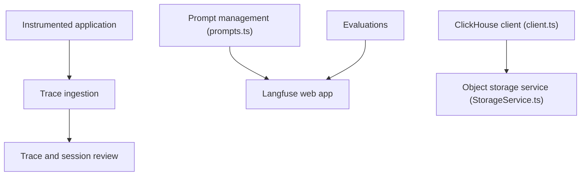

# langfuse/langfuse

> Open-source observability and evaluation platform for LLM applications and agents, in the cloud or self-hosted.

## The problem
Without tracing, you do not know what LLM calls and agents cost, or how they behave, in production.

## What it actually does
Trace ingestion (OpenTelemetry), prompt management and versioning, playground, evaluations (LLM-as-judge, code evaluators, user feedback), datasets and experiments, cost and latency dashboards. In beta: agent skills management and a gateway to model providers. Python and JS/TS SDKs, OpenAPI API. Storage relies on ClickHouse.

## How it is wired


## Trying it
```bash
git clone --depth=1 https://github.com/langfuse/langfuse.git
cd langfuse
docker compose up
pip install langfuse openai
```
Variables `LANGFUSE_SECRET_KEY`, `LANGFUSE_PUBLIC_KEY`, `LANGFUSE_BASE_URL`, then the `@observe()` decorator.

## Cost and gotchas
Cloud with a free tier and no credit card; self-hosting via Docker Compose, or Helm in production. License present but not identified by GitHub: to be checked, notably the enterprise features.

## What it is not
Not an agent framework nor a model host: it observes and evaluates. The README says the team has been part of ClickHouse since January 2026.

## Alternatives
No alternative named in the README; it does, however, list Promptfoo among its integrations.

## For you
A central MLOps building block for LLM applications: tracing, evaluation and costs in one place; adopt, after checking the license.
