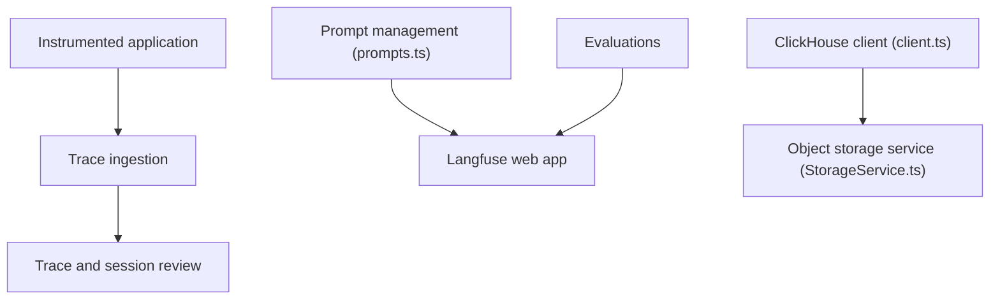

# langfuse/langfuse

> Plateforme libre d'observabilité et d'évaluation pour applications LLM et agents, en cloud ou auto-hébergée.

## Le problème
Sans traçage, on ne sait pas ce que coûtent, ni comment se comportent, les appels LLM et les agents en production.

## Ce que ça fait vraiment
Ingestion de traces (OpenTelemetry), gestion et versionnement de prompts, playground, évaluations (LLM-juge, évaluateurs de code, retours utilisateurs), jeux de données et expériences, tableaux de bord de coûts et de latence. En bêta : gestion de skills d'agents et passerelle vers les fournisseurs de modèles. SDK Python et JS/TS, API OpenAPI. Le stockage s'appuie sur ClickHouse.

## Comment c'est branché


## Essayer
```bash
git clone --depth=1 https://github.com/langfuse/langfuse.git
cd langfuse
docker compose up
pip install langfuse openai
```
Variables `LANGFUSE_SECRET_KEY`, `LANGFUSE_PUBLIC_KEY`, `LANGFUSE_BASE_URL`, puis décorateur `@observe()`.

## Coût et pièges
Cloud avec offre gratuite sans carte bancaire ; auto-hébergement via Docker Compose, ou Helm en production. Licence présente mais non identifiée par GitHub : à vérifier, notamment les fonctions d'entreprise.

## Ce que ce n'est pas
Pas un framework d'agents ni un hébergeur de modèles : il observe et évalue. Le README dit que l'équipe fait partie de ClickHouse depuis janvier 2026.

## Alternatives
Aucune alternative nommée dans le README ; il liste en revanche Promptfoo parmi ses intégrations.

## Pour toi
Brique centrale du MLOps des applications LLM : traçage, évaluation et coûts au même endroit ; à adopter, après vérification de la licence.

