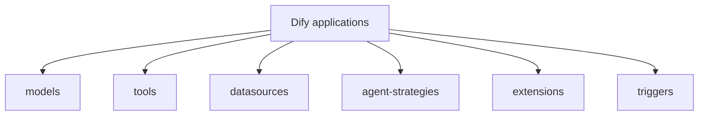

# langgenius/dify-official-plugins

> Repository of Dify's official plugins (models, tools, agent strategies, extensions), for users of the platform.

## The problem
Since Dify v1.0.0 (February 2025), models and tools are no longer in the main repository; somewhere is needed to maintain them.

## What it actually does
- Model plugins (OpenAI, Anthropic, Azure OpenAI), tools (Notion, ComfyUI, e-mail, SlideSpeak).
- Data sources (S3, cloud storage, Notion), agent strategies (ReAct, self-refine).
- HTTP extensions (Slack bot, OpenAI-compatible) and triggers (Telegram).
- Published on the Dify Marketplace.

## How it is wired


## Trying it
```bash
uv lock
uv sync --frozen
```
These are the only commands in the README, for managing a plugin's dependencies; installation goes through the Dify Marketplace.

## Cost and gotchas
Useless without a Dify instance. The services called (models, Notion, etc.) have their own costs; the README does not detail them.

## What it is not
Not a platform: only the plugins. The README does not describe any plugin in detail; there are 100 open issues.

## Alternatives
None named in the README.

## For you
Watch: relevant only if you use Dify, where these plugins are the official route anyway.
