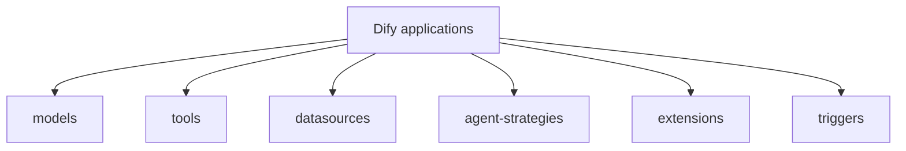

# langgenius/dify-official-plugins

> Dépôt des plugins officiels de Dify (modèles, outils, stratégies d'agent, extensions), pour utilisateurs de la plateforme.

## Le problème
Depuis Dify v1.0.0 (février 2025), modèles et outils ne sont plus dans le dépôt principal ; il faut un endroit pour les maintenir.

## Ce que ça fait vraiment
- Plugins de modèles (OpenAI, Anthropic, Azure OpenAI), outils (Notion, ComfyUI, e-mail, SlideSpeak).
- Sources de données (S3, cloud storage, Notion), stratégies d'agent (ReAct, self-refine).
- Extensions HTTP (bot Slack, compatible OpenAI) et déclencheurs (Telegram).
- Publiés sur le Dify Marketplace.

## Comment c'est branché


## Essayer
```bash
uv lock
uv sync --frozen
```
Ce sont les seules commandes du README, pour gérer les dépendances d'un plugin ; l'installation passe par le Marketplace de Dify.

## Coût et pièges
Inutile sans une instance Dify. Les services appelés (modèles, Notion, etc.) ont leurs propres coûts ; le README ne les détaille pas.

## Ce que ce n'est pas
Pas une plateforme : seulement les plugins. Le README ne décrit aucun plugin en détail ; il y a 100 issues ouvertes.

## Alternatives
Aucune nommée dans le README.

## Pour toi
À surveiller : pertinent seulement si tu utilises Dify, où ces plugins sont de toute façon la voie officielle.

