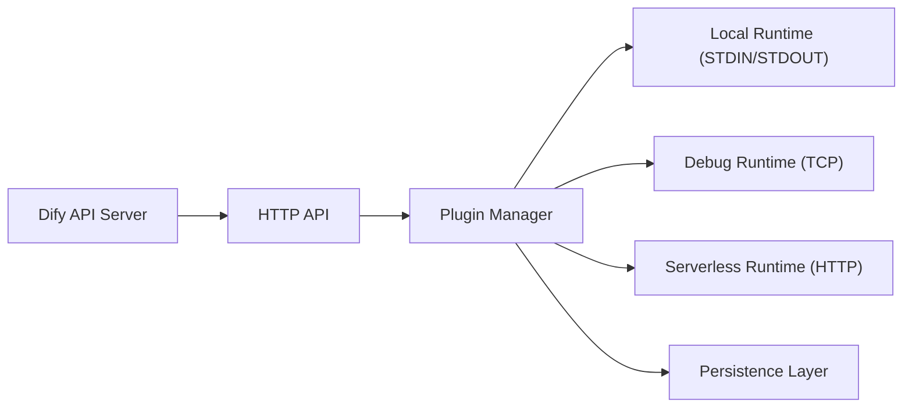

# langgenius/dify-plugin-daemon

> Service that manages the lifecycle and execution of plugins for the Dify platform, for Dify operators.

## The problem
Dify has to install, isolate and invoke plugins per workspace, locally as well as serverless.

## What it actually does
A Go daemon receives HTTP requests from the Dify API server then forwards them according to three runtimes: local (subprocess via STDIN/STDOUT), debug (full-duplex TCP) and serverless (AWS Lambda over HTTP). It uses uv for the plugins' Python dependencies and relies on a MySQL/PostgreSQL database and Redis. A CLI (brew or binary) helps with plugin development.

## How it is wired


## Trying it
```bash
brew tap langgenius/dify
brew install dify
cp .env.example .env
go run github.com/joho/godotenv/cmd/godotenv@latest -f .env go run cmd/server/main.go
go run ./cmd/commandline/ migrate
```

## Cost and gotchas
Linux and macOS only. Python 3.11+ and uv must be installed. Avoid network volumes for the working directory. The community edition does not scale with multiple replicas.

## What it is not
Not useful outside Dify: it is not a generic plugin system. Kubernetes scaling is reserved for an enterprise version.

## Alternatives
No alternative named in the README.

## For you
Worth watching: only useful if you self-host Dify and need to understand its plugins; otherwise, no direct interest.
