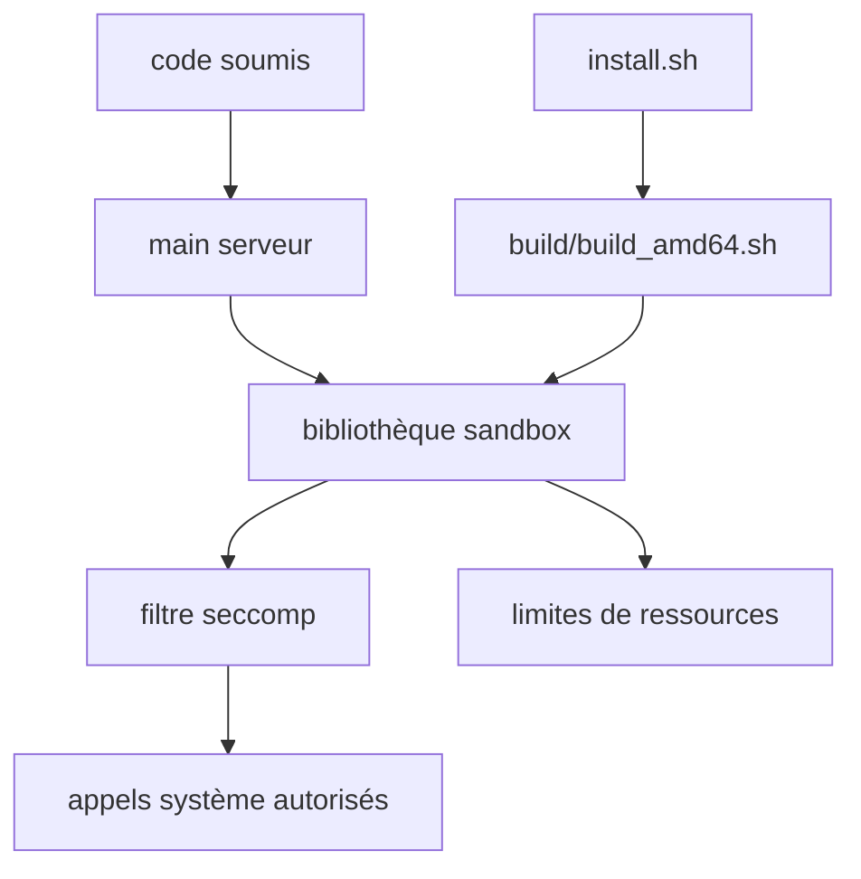

# langgenius/dify-sandbox

> Linux sandbox that runs untrusted code by restricting system calls and resources.

## The problem
Letting an agent or a user run arbitrary code on a shared server exposes the whole machine.
A plain container is not enough when several tenants submit code at the same time.

## What it actually does
Runs submitted code in a restricted environment, designed for multi-tenant use.
The restriction applies to resources and to the system calls available to the code, via `libseccomp`.
It is built in two steps: a script that installs dependencies, then a build script per architecture (amd64 or arm64).
The server is then started with a single binary.

## How it is wired


## Trying it
```bash
git clone https://github.com/langgenius/dify-sandbox
./install.sh
./build/build_amd64.sh
./main
```

## Cost and gotchas
Linux only: the project is designed for Docker containers and does not claim to work elsewhere.
Build dependencies to install: `libseccomp`, `pkg-config`, `gcc` and Go 1.20.6.

## What it is not
Not a virtual machine: isolation relies on seccomp and resource limits, not on a hardware boundary.
Not a documented standalone product: the README describes neither the API, nor the accepted languages, nor the configuration.
Not cross-platform: nothing is planned for macOS or Windows.

## Alternatives
No alternative named in the README.

## For you
The component to know if you run LLM-generated code; the documentation is too thin to adopt it without reading the code.
