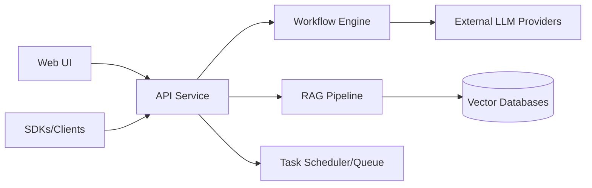

# langgenius/dify

> Self-hosted platform for building LLM applications: visual workflows, RAG (Retrieval-Augmented Generation), agents, and monitoring.

## The problem
Developing an LLM application (including prompts, RAG, tools, logs, and APIs) requires assembling and maintaining many components manually.

## What it actually does
A visual workflow consists of the different stages; a RAG pipeline ingests documents (PDF, PPT, etc.) and queries a vector database; agents have a sandbox and tools (Dify Marketplace, MCP servers, custom API).
Hundreds of proprietary or open models are available through providers, including all models compatible with OpenAI. Logs and annotations for "LLMOps," integrations with Opik, Langfuse, and Arize Phoenix. Each application exposes an API.
On the code side: backend `api/` (controllers, services, asynchronous tasks), frontend `web/`, Node/PHP/Python SDK, deployment `docker/`. The provided architectural analysis is generic: few real file names.

## How it is wired


## Trying it
```bash
cd dify
cd docker
cp .env.example .env
docker compose up -d
```

## Cost and gotchas
Minimum 2 cores and 4 GB of RAM, Docker Compose ≥ 2.24. Dify Cloud offers 200 free GPT-4 calls; for self-hosting, you are responsible for obtaining the model keys. SSO and RBAC are part of the Enterprise offering.

## What it is not
Not a library to import: a complete server to operate. Business functions (SSO, RBAC, SLA) are not included in the community edition. The license is not identified by GitHub: please read before commercial use.

## Alternatives
No alternative is specified in the README file.

## For you
This is ideal for quickly prototyping a RAG (Retrieval-Augmented Generation) model or agent with a user interface. However, for custom solutions, it's generally better to use existing code.
