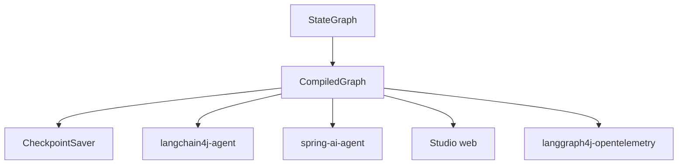

# langgraph4j/langgraph4j

> Java port of LangGraph for building stateful multi-agent applications with LLMs.

## The problem
Orchestrating agents with loops, memory and resumption is hard in Java without a dedicated framework.

## What it actually does
You define a `StateGraph` of nodes and edges (conditional or not) with a shared state. It offers checkpoints (memory, MySQL, Postgres, Redis, MongoDB), streaming, subgraphs, parallel execution and a web Studio. LangChain4j and Spring AI integrations.

## How it is wired
Diagram based on the documented structure.



## Trying it
```bash
# Dépendance Maven : org.bsc.langgraph4j:langgraph4j-core:1.9.8 (Java 17+)
```

## Cost and gotchas
Java 17+; LLM calls cost according to the provider or run with Ollama locally. The 1.9 branch carries experimental features ahead of 2.0.

## What it is not
Not the Python LangGraph: an inspired port, with its own modules. Not a ready-to-use agent.

## Alternatives
Spring AI and langchain4j are cited as frameworks it builds on; an article compares them to LangGraph4j.

## For you
Worth watching: useful only if your agents run in Java; in Python, LangGraph remains more direct.
