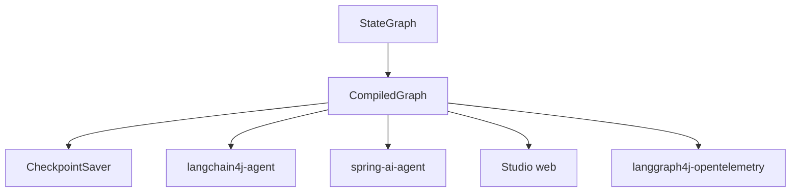

# langgraph4j/langgraph4j

> Port Java de LangGraph pour construire des applications multi-agents à état avec LLM.

## Le problème
Orchestrer des agents avec boucles, mémoire et reprise est difficile en Java sans un cadre dédié.

## Ce que ça fait vraiment
On définit un `StateGraph` de nœuds et d'arêtes (conditionnelles ou non) avec un état partagé. Il offre checkpoints (mémoire, MySQL, Postgres, Redis, MongoDB), streaming, sous-graphes, exécution parallèle et un Studio web. Intégrations LangChain4j et Spring AI.

## Comment c'est branché
Schéma d'après la structure documentée.



## Essayer
```bash
# Dépendance Maven : org.bsc.langgraph4j:langgraph4j-core:1.9.8 (Java 17+)
```

## Coût et pièges
Java 17+ ; les appels LLM coûtent selon le fournisseur ou fonctionnent avec Ollama en local. La branche 1.9 porte des fonctions expérimentales avant le 2.0.

## Ce que ce n'est pas
Pas le LangGraph Python : un port inspiré, avec ses propres modules. Pas un agent prêt à l'emploi.

## Alternatives
Spring AI et langchain4j sont cités comme cadres sur lesquels il s'appuie ; un article les compare à LangGraph4j.

## Pour toi
À surveiller : utile seulement si tes agents tournent en Java ; en Python, LangGraph reste plus direct.

