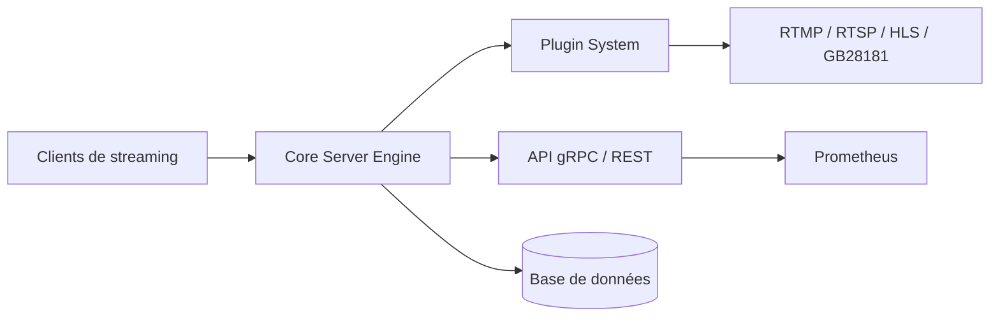

# langhuihui/monibuca

> Go video streaming server framework, extensible through plugins, for broadcasting and recording.

## The problem
Broadcasting and receiving video streams over several protocols requires an adaptable, low-latency server.

## What it actually does
A Go core manages publishers and subscribers; plugins add the protocols (RTMP, RTSP, HTTP-FLV, HLS, WebRTC, GB28181, ONVIF, SRT), recording (MP4, HLS, FLV), cascading and rooms, transcoding, snapshots and webhooks. gRPC/REST interface, Prometheus metrics at `/api/metrics`, and a choice of databases (SQLite, MySQL, PostgreSQL, DuckDB) via build tags. The README also mentions ONNX inference.

## How it is wired


## Trying it
```bash
cd example/default
go run -tags sqlite main.go
```
Then open http://localhost:8080 with `admin.zip` placed next to the configuration file.

## Cost and gotchas
Go 1.23+. AGPL-3.0 license: a modified network service must publish its sources. The README's performance claims are not quantified.

## What it is not
It is not a turnkey product: it is a framework to compile. It is not AI-centered, despite the inference module mentioned.

## Alternatives
No alternative named in the README.

## For you
Ignore: a streaming server with no direct link to data or MLOps, and the AGPL restricts commercial uses.
