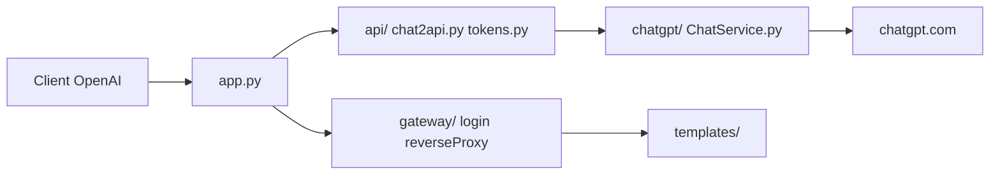

# lanqian528/chat2api

> Proxy that exposes the ChatGPT web interface as an OpenAI-format API, for personal use.

## The problem
Using OpenAI-compatible clients with a ChatGPT account without going through the paid official API.

## What it actually does
The Python server (`app.py`, modules `api/`, `chatgpt/`, `gateway/`) translates `/v1/chat/completions` requests into calls to chatgpt.com. It accepts AccessTokens or RefreshTokens, rotates across several accounts, retries on failure and refreshes tokens. It also offers a "mirror" of the official site behind `/login`, and an account-less mode for GPT-3.5. The README is in Chinese.

## How it is wired


## Trying it
```bash
docker run -d \
  --name chat2api \
  -p 5005:5005 \
  lanqian528/chat2api:latest
```

## Cost and gotchas
You need an AccessToken retrieved by hand from chatgpt.com. Depending on the IP, 401/403/429 errors; the README suggests a proxy or a US IP. Gateway mode (`ENABLE_GATEWAY`) opens access to anyone who can reach your domain.

## What it is not
It is not an official API: it reproduces the web interface (proof of work included) and may break with every change on OpenAI's side. The README itself mentions a setting to limit the risk of account bans.

## Alternatives
No alternative is cited in the README.

## For you
Ignore it: fragile workaround of a third-party service, risk to your account, a single maintainer, last push in May 2025; use the official API for any serious use.
