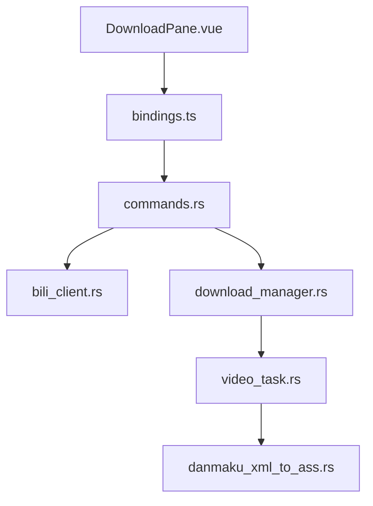

# lanyeeee/bilibili-video-downloader

> Desktop application to download Bilibili videos with subtitles and danmaku.

## The problem
Retrieving Bilibili videos with their metadata for a local media library is manual.

## What it actually does
A Tauri v2 application (Vue interface, Rust backend) downloads videos, series, courses, audio, subtitles, danmaku (converted to ASS) and covers, in fragments with resume. It writes NFO files for Emby and chapter and advertisement markers. A plugin system via dynamic libraries exists, with no security restrictions at all. The README is in Chinese.

## How it is wired


## Trying it
```bash
git clone https://github.com/lanyeeee/bilibili-video-downloader.git
cd bilibili-video-downloader
pnpm install
pnpm tauri build
```

## Cost and gotchas
Free; building requires Rust, Node and pnpm. The README warns of antivirus false positives and insecure plugins: load no third-party binary.

## What it is not
It is not a monitoring or data tool. The author disclaims all responsibility regarding rights and legality.

## Alternatives
No alternative named in the README.

## For you
Ignore: a Bilibili video downloader does not serve data, AI or MLOps work, and raises rights questions.
