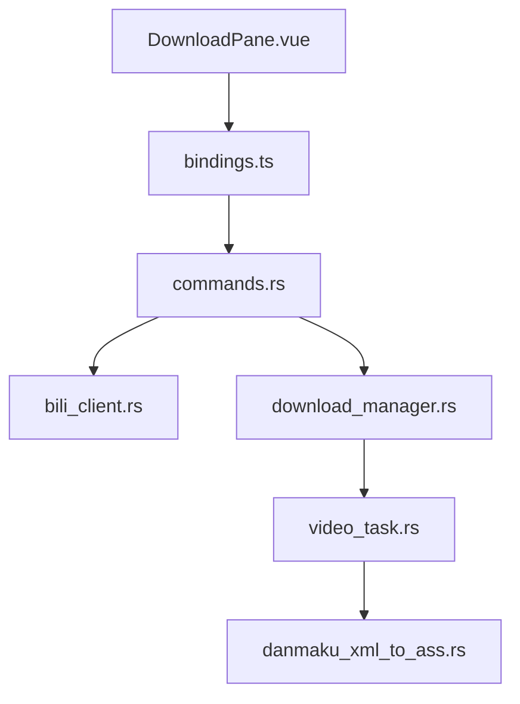

# lanyeeee/bilibili-video-downloader

> Application de bureau pour télécharger des vidéos Bilibili avec sous-titres et danmaku.

## Le problème
Récupérer des vidéos Bilibili avec leurs métadonnées pour une médiathèque locale est manuel.

## Ce que ça fait vraiment
Une application Tauri v2 (interface Vue, backend Rust) télécharge vidéos, séries, cours, audio, sous-titres, danmaku (convertis en ASS) et pochettes, par fragments avec reprise. Elle écrit des fichiers NFO pour Emby et des marqueurs de chapitres et de publicités. Un système de plugins par bibliothèque dynamique existe, sans aucune restriction de sécurité. Le README est en chinois.

## Comment c'est branché


## Essayer
```bash
git clone https://github.com/lanyeeee/bilibili-video-downloader.git
cd bilibili-video-downloader
pnpm install
pnpm tauri build
```

## Coût et pièges
Gratuit ; compilation avec Rust, Node et pnpm. Le README prévient de faux positifs antivirus et de plugins non sécurisés : ne charger aucun binaire tiers.

## Ce que ce n'est pas
Ce n'est pas un outil de veille ou de data. L'auteur décline toute responsabilité quant aux droits et à la légalité.

## Alternatives
Aucune alternative nommée dans le README.

## Pour toi
À ignorer : un téléchargeur de vidéos Bilibili ne sert pas un travail data, IA ou MLOps, et pose des questions de droits.

