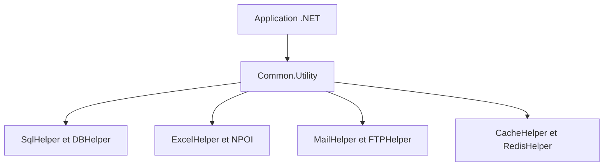

# laochiangx/Common.Utility

> Collection of C# utility classes (files, e-mail, Excel, cache, database…), documented mostly in Chinese.

## The problem
.NET projects keep rewriting the same basic tools: string handling, files, HTTP, encryption.

## What it actually does
The README only lists the helper classes, for example `ADHelper`, `CacheHelper`, `ExcelHelper`, `FTPHelper`, `MailHelper`, `RedisHelper`, `MongoDBHelper`, `SqlHelper`, `QRcode` and `VideoConvert`, with no usage description. The documentation points to a blog article and a Sandcastle file. The exact behavior is not documented.

## How it is wired

Simplified diagram based on the sheet, no diagram provided.

## Trying it
No documented command.

## Cost and gotchas
Free, but no license: use is not explicitly permitted. Last push in December 2022. Needs a .NET (C#) environment, not Python.

## What it is not
It is not a properly published library: no installation or API described. It is not a data tool.

## Alternatives
No alternative named in the README.

## For you
Ignore: a pile of C# helpers with no license, no instructions, abandoned since 2022.
